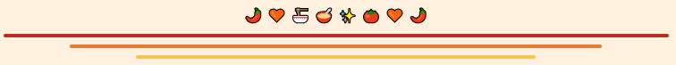

 <div align="center">

  

  

  ### 🍜 Welcome to Our Little Project! ♡

  *Local Taste, Digital Experience*

  

  
  
  

  <br/>

  <a href="https://mppl01022026.github.io/kelompok-4/">
    
  </a>

  <br/>

  **૮₍ ˶•⤙•˶ ₎ა Semangkuk Bakso, Sejuta Cerita! ૮₍ ˶ᵔ ᵕ ᵔ˶ ₎ა**

  *Menghadirkan cita rasa lokal ke dunia digital, satu mangkuk penuh cerita.* 💌

  

</div>

---

## 🍜 01. Hello, Everyone!

Hiii, everyone! ♡

Selamat datang di repository resmi **Kelompok 4** dalam proyek pengembangan perangkat lunak untuk UMKM **Bakso Jambo Langsa, Aceh**.

Repository ini menjadi tempat kami berkolaborasi, berbagi ide, menyusun dokumentasi, dan mengembangkan website untuk memperkenalkan usaha kuliner lokal melalui media digital.

Kami ingin menghadirkan website yang informatif, menarik, dan mudah diakses agar pelanggan dapat mengenal usaha, melihat menu, serta memperoleh informasi yang dibutuhkan.

<div align="center">

**Small Business, Big Digital Impact!**

*Made with teamwork, creativity, and a little bowl of bakso.* 🍜

</div>

## 🍮 02. About Our Project

| Informasi | Keterangan |
|:--|:--|
| 🍜 Nama Proyek | Website UMKM Bakso Jambo Langsa |
| 👩🏻‍💻 Nama Kelompok | Kelompok 4 |
| 📦 Repository | `MPPL01022026/kelompok-4` |
| 🏫 Bidang | Pengembangan Perangkat Lunak |
| 🔄 Metodologi | Agile |
| 🚀 Tahapan | Sprint 1 |
| 🎯 Target Pengguna | Pelanggan dan pengelola UMKM |
| 📍 Lokasi UMKM | Langsa, Aceh |

### 🎀 Our Goals

- 💗 Memperkenalkan UMKM Bakso Jambo Langsa melalui website.
- 🍜 Menampilkan menu, harga, dan foto produk.
- 📸 Menyediakan galeri foto untuk pengunjung.
- ☁️ Mengembangkan fitur unggah foto melalui penyimpanan online.
- 📍 Memudahkan pelanggan mendapatkan informasi usaha.
- 🤝 Menerapkan kolaborasi menggunakan Git dan GitHub.

## 🥢 03. Website Features

<table>
<tr>
<td align="center" width="50%">

### 🏠 Beranda

Halaman utama yang memperkenalkan Bakso Jambo Langsa dengan tampilan menarik.

</td>
<td align="center" width="50%">

### 🍜 Menu Bakso

Informasi menu dan harga untuk membantu pelanggan mengenal pilihan produk.

</td>
</tr>
<tr>
<td align="center" width="50%">

### 📸 Galeri Foto

Kumpulan foto produk yang dapat dilihat pengunjung website.

</td>
<td align="center" width="50%">

### ☁️ Upload Foto

Fitur bagi pengelola untuk menambahkan foto produk melalui penyimpanan online.

</td>
</tr>
<tr>
<td align="center" width="50%">

### 🏪 Tentang Kami

Informasi mengenai usaha dan pengenalan UMKM Bakso Jambo Langsa.

</td>
<td align="center" width="50%">

### 📍 Lokasi dan Kontak

Informasi lokasi dan kontak usaha untuk membantu pelanggan menemukan UMKM.

</td>
</tr>
</table>

> 💌 **Catatan:** Ketersediaan fitur mengikuti implementasi kode yang telah selesai. Fitur yang membutuhkan backend harus dikonfigurasi dan diuji terlebih dahulu.

## 🎨 04. Our Cute Color Palette

<div align="center">

| Warna | Kode | Nuansa |
|:--|:--|:--|
| 🔴 Merah Bakso | `#B83227` | Berani dan menggugah selera |
| 🧡 Oranye | `#E87936` | Hangat dan ceria |
| 🍮 Krem | `#FFCB8E` | Lembut dan manis |
| 🤎 Cokelat | `#68443A` | Natural dan nyaman |

</div>

Konsep visual kami menggabungkan warna hangat, dekorasi lucu, banner bergelombang, dan badge untuk menciptakan identitas yang ramah serta mudah dikenali.

## 👩🏻‍🍳 05. Meet Our Awesome Team

<div align="center">


*Four Members, One Dream!* 💗

</div>

<table>
<tr>
<td align="center" width="25%">


### Rani Simahbengi

🌷 Anggota Kelompok 4

</td>
<td align="center" width="25%">


### Anisa Aulia

🍊 Anggota Kelompok 4

</td>
<td align="center" width="25%">


### Zaskia Lexsa

🍮 Anggota Kelompok 4

</td>
<td align="center" width="25%">


### M. Rizki Foenna

🍜 Anggota Kelompok 4

</td>
</tr>
</table>

<div align="center">

૮₍ ˶ᵔ ᵕ ᵔ˶ ₎ა

**Together We Learn, Together We Build!**

*Bersama belajar, berkolaborasi, dan menciptakan solusi digital untuk UMKM lokal.* 💌

</div>

## 🛠️ 06. Technologies We Use

<div align="center">


</div>

| Teknologi | Kegunaan |
|:--|:--|
| HTML | Membuat struktur halaman website |
| CSS | Mengatur warna, tata letak, dan tampilan |
| JavaScript | Menambahkan interaksi dan fungsionalitas |
| Git | Melacak perubahan kode |
| GitHub | Menyimpan repository dan mendukung kolaborasi |
| Supabase | Layanan backend untuk database dan penyimpanan foto jika dikonfigurasi |

## 📂 07. Repository Structure

Struktur repository proyek direncanakan seperti berikut. Daftar ini perlu disesuaikan jika ada file yang belum dibuat atau memiliki nama berbeda.

```text
kelompok-4/
├── assets/
│   └── images/
├── css/
│   └── style.css
├── js/
│   ├── app.js
│   └── supabase.js
├── docs/
│   ├── wbs.md
│   ├── gantt-chart.md
│   ├── agile-methodology.md
│   ├── function-point.md
│   ├── project-setup.md
│   └── ux-design.md
├── index.html
├── README.md
└── .gitignore
```

> **Penting:** File gambar banner dan divider yang digunakan README harus tersedia di repository dengan nama dan lokasi yang sesuai. Struktur folder di atas merupakan gambaran, bukan konfirmasi bahwa semua file sudah tersedia.

## 📚 08. Sprint 1 Documentation

Dokumentasi berikut menjadi bagian dari proses analisis, perencanaan, penjadwalan, dan perancangan proyek Website UMKM Bakso Jambo Langsa.

| Dokumen | Penjelasan |
|:--|:--|
| [📌 Work Breakdown Structure](docs/wbs.md) | Pembagian pekerjaan dan ruang lingkup proyek |
| [📅 Project Schedule / Gantt Chart](docs/gantt-chart.md) | Jadwal aktivitas proyek dalam bentuk diagram Gantt |
| [🔄 Agile Methodology](docs/agile-methodology.md) | Metode pengembangan dan perencanaan sprint |
| [📊 Function Point Analysis](docs/function-point.md) | Estimasi ukuran fungsional sistem |
| [⚙️ Project Setup](docs/project-setup.md) | Panduan konfigurasi proyek |
| [🎨 UX Design](docs/ux-design.md) | Rancangan antarmuka dan pengalaman pengguna |

### 📅 Project Schedule Preview

Gantt Chart digunakan untuk melihat urutan pekerjaan, durasi, serta jadwal pelaksanaan proyek. Diagram lengkap dapat dilihat melalui dokumen berikut:

**[📊 Buka Project Schedule / Gantt Chart](docs/gantt-chart.md)**

Dokumen tersebut memuat jadwal aktivitas, diagram Gantt, milestone, serta asumsi pengendalian jadwal proyek.

## 🤝 09. Collaboration Workflow

Kami menggunakan GitHub untuk berkolaborasi, mengelola kode, dan mendokumentasikan perkembangan proyek.

<div align="center">

**📝 PLAN → 💻 DEVELOP → 🔍 REVIEW → 🔗 INTEGRATE → 🎉 EVALUATE**

</div>

1. Membagi tugas sesuai kesepakatan kelompok.
2. Mengembangkan fitur dan dokumentasi secara bertahap.
3. Menggunakan Git untuk mencatat perubahan.
4. Memeriksa kode sebelum menggabungkan perubahan.
5. Memperbarui dokumentasi sesuai progres.
6. Mengevaluasi hasil pekerjaan pada akhir sprint.

## 🚀 10. Our Development Checklist

Checklist berikut digunakan untuk memantau progres pengembangan website dan dapat diperbarui sesuai kondisi pekerjaan sebenarnya.

- [ ] Menyelesaikan desain antarmuka website.
- [ ] Melengkapi informasi menu dan profil UMKM.
- [ ] Menambahkan galeri foto produk.
- [ ] Menghubungkan fitur upload foto ke penyimpanan online.
- [ ] Menguji tampilan di desktop dan perangkat mobile.
- [ ] Melakukan pengujian fungsional.
- [ ] Memastikan tautan dan dokumentasi berfungsi.
- [ ] Memastikan publikasi website berjalan dengan baik.

## 🌟 11. Our Vision

Kami percaya bahwa teknologi dapat membantu UMKM lokal menjangkau lebih banyak pelanggan.

Melalui proyek website Bakso Jambo Langsa, kami ingin memadukan kreativitas, teknologi, dan kerja sama tim untuk menghasilkan solusi digital yang bermanfaat.

<div align="center">

🌷 ─────────────── 🌷

### 🍜 Local Taste, Digital Future!

**Learn Together ♡ Build Together ♡ Grow Together**

૮₍ ˶ᵔ ᵕ ᵔ˶ ₎ა 💗 🍜


**Made with ❤️ by Kelompok 4**

*MPPL — Sprint 1*

⭐ Thank you for visiting our little corner! ⭐

</div>
