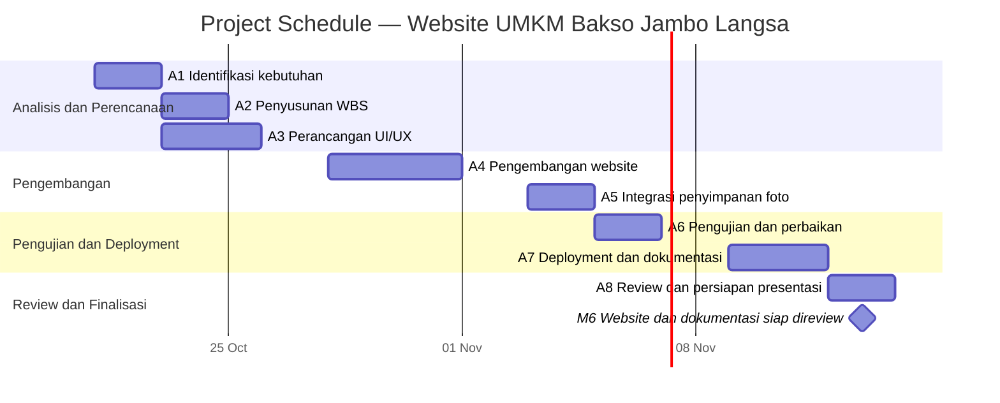

# Project Schedule / Gantt Chart

## Informasi Proyek
- **Nama proyek:** Digitalisasi UMKM Bakso Jambo Langsa
- **Tim:** Kelompok 4 — MPPL
- **Periode rencana:** 21 Oktober–13 November 2026
- **Catatan:** Jadwal ini adalah baseline awal yang dibuat untuk keperluan perencanaan. Sesuaikan tanggal jika jadwal resmi kelompok berbeda.

## Jadwal Aktivitas

| ID | Aktivitas | Durasi (hari kerja) | Mulai | Selesai | Dependensi | Penanggung Jawab | Output |
|---|---|---:|---|---|---|---|---|
| A1 | Identifikasi kebutuhan dan ruang lingkup UMKM | 2 | 21 Okt 2026 | 22 Okt 2026 | — | Seluruh anggota | Daftar kebutuhan |
| A2 | Penyusunan WBS dan rencana proyek | 2 | 23 Okt 2026 | 26 Okt 2026 | A1 | Rani Simahbengi | WBS dan rencana kerja |
| A3 | Perancangan UI/UX website | 3 | 23 Okt 2026 | 27 Okt 2026 | A1 | Anisa Aulia | Rancangan antarmuka |
| A4 | Pengembangan halaman website | 4 | 28 Okt 2026 | 2 Nov 2026 | A2, A3 | Zaskia Lexsa | Halaman website |
| A5 | Integrasi penyimpanan foto online | 2 | 3 Nov 2026 | 4 Nov 2026 | A4 | M. Rizki Foenna | Fitur foto terintegrasi |
| A6 | Pengujian dan perbaikan | 2 | 5 Nov 2026 | 6 Nov 2026 | A5 | Seluruh anggota | Hasil pengujian |
| A7 | Deployment dan penyusunan dokumentasi | 3 | 9 Nov 2026 | 11 Nov 2026 | A6 | Zaskia Lexsa dan M. Rizki Foenna | Website terpublikasi dan dokumentasi |
| A8 | Review, revisi akhir, dan persiapan presentasi | 2 | 12 Nov 2026 | 13 Nov 2026 | A7 | Seluruh anggota | Hasil review dan bahan presentasi |

## Gantt Chart

Diagram berikut menunjukkan jadwal aktivitas proyek berdasarkan tanggal mulai dan selesai yang telah direncanakan. Beberapa aktivitas berjalan secara paralel sesuai dependensinya.

**Keterangan:**
- Batang horizontal menunjukkan rentang waktu pelaksanaan setiap aktivitas.
- Aktivitas A2 dan A3 direncanakan berlangsung bersamaan.
- Milestone M6 menandai target kesiapan website dan dokumentasi untuk direview.
- Jadwal merupakan rencana (*baseline*), bukan bukti bahwa aktivitas telah selesai.

## Milestone

| Kode | Milestone | Target | Kriteria Selesai |
|---|---|---|---|
| M1 | Kebutuhan proyek disepakati | 22 Okt 2026 | Kebutuhan dan ruang lingkup terdokumentasi |
| M2 | WBS dan rancangan UI/UX siap | 27 Okt 2026 | WBS serta rancangan awal ditinjau tim |
| M3 | Fitur utama website selesai | 2 Nov 2026 | Halaman utama dan bagian inti dapat digunakan |
| M4 | Integrasi foto selesai | 4 Nov 2026 | Unggah/tampil foto diuji sesuai konfigurasi layanan |
| M5 | Pengujian selesai | 6 Nov 2026 | Temuan utama dicatat dan diperbaiki |
| M6 | Website dan dokumentasi siap direview | 13 Nov 2026 | Tautan website dan dokumen diperiksa |

## Asumsi dan Pengendalian
1. Hari kerja adalah Senin–Jumat; hari libur khusus belum diperhitungkan.
2. Beberapa aktivitas dapat berjalan paralel jika dependensinya memungkinkan.
3. Jika ada perubahan kebutuhan atau keterlambatan, koordinator memperbarui tanggal dan menyampaikan dampaknya kepada tim.
4. Status setiap aktivitas perlu diperbarui berdasarkan progres nyata saat rapat tim.
